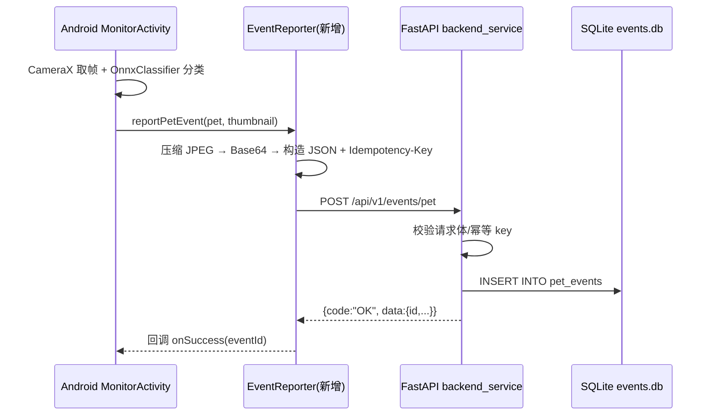

# EdgeVision-ONNX 端云联调指南（Android ↔ FastAPI）

> 本文档给出 Android 端侧 App 与 Python FastAPI 后端（`backend_service/`）的完整联调方案。
> 联调目标：让「宠物监控」页识别到猫/狗后，把抓拍事件（缩略图、类别、置信度、时间戳、设备 ID）通过 HTTP 上报到后端，并能在后端查询、生成日报。

---

## 一、联调目标与数据流

端侧识别到宠物 → 构造抓拍事件 → 带 `Idempotency-Key` 幂等上报 → 后端落库 SQLite → 可查询 / 生成日报。



---

## 二、现状盘点（联调前必读）

1. **后端已完整实现**，三个路由均可用：
   - `POST /api/v1/events/pet`（接收事件，幂等防重）
   - `GET /api/v1/events`（按时间/类别分页查询）
   - `POST /api/v1/reports/daily`（日报，无 LLM key 时降级本地统计）

2. **Android 端当前只做本地记录、未实现 HTTP 上报**。`MonitorActivity.recordPetEvent()` 仅把事件写入界面日志（[MonitorActivity.java](file:///d:/Desktop/DSH/EdgeVision-ONNX/android_app/app/src/main/java/com/edgevision/onnx/ui/MonitorActivity.java) 第 247~259 行），没有网络请求。联调前需新增一个 `EventReporter` 并改造 `MonitorActivity`（见第五节）。

3. **两个环境级坑点（联调最常见失败原因）**：
   - **明文 HTTP 被拦截**：Android 9（API 28）起默认禁止 `http://` 明文流量，联调用局域网 HTTP 必须显式放行（`usesCleartextTraffic` 或 networkSecurityConfig）。
   - **真机访问不到 `localhost`**：真机里的 `localhost`/`127.0.0.1` 指向手机自身，必须用后端所在电脑的**局域网 IP**（如 `192.168.x.x`），且后端须以 `--host 0.0.0.0` 启动。

---

## 三、后端启动与自测

### 3.1 安装依赖与启动

```bash
cd backend_service
python -m venv .venv && source .venv/bin/activate   # Windows 用 .venv\Scripts\activate
pip install -r requirements.txt

# 以 0.0.0.0 启动，供同一局域网的真机访问
uvicorn main:app --host 0.0.0.0 --port 8000
```

- 数据库默认生成在 `backend_service/events.db`（可用环境变量 `EDGEVISION_DB_PATH` 改路径）。
- 可选环境变量：`MAX_REQUEST_BYTES`（请求体上限，默认 512KB）、`OPENAI_API_KEY` / `OPENAI_BASE_URL` / `OPENAI_MODEL`（日报 LLM 摘要，缺省自动降级本地统计）。

### 3.2 用 curl 自测三个接口

（1）上报一个宠物事件：

```bash
curl -X POST http://127.0.0.1:8000/api/v1/events/pet \
  -H "Content-Type: application/json" \
  -H "Idempotency-Key: test-key-001" \
  -d '{
    "thumbnail": "iVBORw0KGgoAAAANSUhEUgAAAAEAAAABCAQAAAC1HAwCAAAAC0lEQVR42mNk+M9QDwADhgGAWjR9awAAAABJRU5ErkJggg==",
    "category": "虎斑猫",
    "confidence": 0.86,
    "timestamp": "2026-11-24T10:00:00.000+00:00",
    "device_id": "android-demo-device"
  }'
```

预期返回（首次 `201`，同 `Idempotency-Key` 重放返回 `200` 且 `data.id` 不变）：

```json
{"code":"OK","message":"事件已接收","data":{"id":1,"thumbnail":"...","category":"虎斑猫","confidence":0.86,"timestamp":"2026-11-24T10:00:00+00:00","device_id":"android-demo-device","created_at":"..."}}
```

（2）分页查询：

```bash
curl -G "http://127.0.0.1:8000/api/v1/events" --data-urlencode "page=1" --data-urlencode "page_size=10" --data-urlencode "pet_type=虎斑猫"
```

（3）生成当日日报（无 key 时返回 `summary_source:"local"`）：

```bash
curl -X POST "http://127.0.0.1:8000/api/v1/reports/daily"
```

#### Windows (cmd) 版命令

cmd 的续行符是 `^`（不是 bash 的 `\`，也不是 PowerShell 的反引号）；JSON 用双引号包裹、内部双引号写 `\"`；中文需先 `chcp 65001` 切到 UTF-8 以免乱码。

（1）上报事件（单行）：

```cmd
chcp 65001
curl.exe -X POST http://127.0.0.1:8000/api/v1/events/pet -H "Content-Type: application/json" -H "Idempotency-Key: test-key-001" -d "{\"thumbnail\":\"iVBORw0KGgoAAAANSUhEUgAAAAEAAAABCAQAAAC1HAwCAAAAC0lEQVR42mNk+M9QDwADhgGAWjR9awAAAABJRU5ErkJggg==\",\"category\":\"虎斑猫\",\"confidence\":0.86,\"timestamp\":\"2026-11-24T10:00:00.000+00:00\",\"device_id\":\"android-demo-device\"}"
```

（2）分页查询：

```cmd
curl.exe -G "http://127.0.0.1:8000/api/v1/events" --data-urlencode "page=1" --data-urlencode "page_size=10" --data-urlencode "pet_type=虎斑猫"
```

（3）生成日报：

```cmd
curl.exe -X POST "http://127.0.0.1:8000/api/v1/reports/daily"
```

> 更省事的方式：浏览器直接打开 `http://127.0.0.1:8000/docs` 的 Swagger UI，点 Try it out 填 JSON 提交，完全避开命令行转义。

---

## 四、后端接口契约（联调对照表）

### 4.1 `POST /api/v1/events/pet`

| 字段 | 类型 | 必填 | 约束 | 说明 |
| :--- | :--- | :--- | :--- | :--- |
| `thumbnail` | string | 是 | 1~300000 字符 | Base64 或 data URL 的抓拍缩略图 |
| `category` | string | 是 | 1~80 字符 | 识别到的宠物类别（联调用中文名，如"虎斑猫"） |
| `confidence` | float | 是 | 0.0~1.0 | softmax 置信度 |
| `timestamp` | datetime | 是 | ISO-8601 | 抓拍时刻，**必须带时区偏移 `+00:00`（不要用 `Z`，Python 3.10 的 `fromisoformat` 不识别 `Z`）** |
| `device_id` | string | 是 | 1~128 字符 | 设备标识（建议 `Settings.Secure.ANDROID_ID`） |

请求头：`Idempotency-Key`（可选，≤200 字符）。同一 key 重放返回原记录（`200`），不同内容同 key 返回 `409 IDEMPOTENCY_CONFLICT`。

### 4.2 `GET /api/v1/events`

| Query | 说明 |
| :--- | :--- |
| `start_time` / `end_time` | 时间范围（ISO-8601） |
| `pet_type` 或 `category` | 精确匹配类别 |
| `page` / `page_size` | 分页，默认 1 / 20，`page_size` ≤ 100 |

### 4.3 `POST /api/v1/reports/daily`

请求体 `{"date":"2026-11-24"}` 或 Query `?date=2026-11-24`；缺省当天。返回 `summary` 与 `summary_source`（`llm` / `local`）。

### 4.4 统一信封

- 成功：`{"code":"OK","message":"...","data":...}`
- 失败：`{"code":"<错误码>","message":"...","data":...}`，常见 `VALIDATION_ERROR`(422)、`PAYLOAD_TOO_LARGE`(413)、`IDEMPOTENCY_CONFLICT`(409)、`INVALID_TIME_RANGE`(400)。

---

## 五、Android 端上报改造

需要改 3 处：加权限（Manifest）、新增 `EventReporter.java`、改造 `MonitorActivity.java`。`build.gradle` **无需改动**（用系统自带 `HttpURLConnection` + `org.json`）。

### 5.1 加网络权限（[AndroidManifest.xml](file:///d:/Desktop/DSH/EdgeVision-ONNX/android_app/app/src/main/AndroidManifest.xml)）

在 `<manifest>` 下加 `INTERNET` 权限，并在 `<application>` 上放行明文 HTTP：

```xml
<uses-permission android:name="android.permission.INTERNET" />

<application
    ...
    android:usesCleartextTraffic="true">
```

> 生产环境应改为 `networkSecurityConfig` 仅放行指定域，或直接上 HTTPS；`usesCleartextTraffic="true"` 仅用于本地联调。

### 5.2 新增 `ml/EventReporter.java`

新建文件 `android_app/app/src/main/java/com/edgevision/onnx/ml/EventReporter.java`：

```java
package com.edgevision.onnx.ml;

import android.content.Context;
import android.graphics.Bitmap;
import android.os.Handler;
import android.os.Looper;
import android.provider.Settings;
import android.util.Base64;
import android.util.Log;

import org.json.JSONObject;

import java.io.ByteArrayOutputStream;
import java.io.InputStream;
import java.io.OutputStream;
import java.net.HttpURLConnection;
import java.net.URL;
import java.nio.charset.StandardCharsets;
import java.time.OffsetDateTime;
import java.time.ZoneOffset;
import java.time.format.DateTimeFormatter;
import java.util.UUID;
import java.util.concurrent.ExecutorService;
import java.util.concurrent.Executors;
import java.util.concurrent.RejectedExecutionException;

/**
 * 端云联动上报器：把端侧宠物抓拍事件 POST 到 FastAPI 后端。
 * 网络请求在单线程 ExecutorService 后台执行，回调切回主线程。
 */
public final class EventReporter {
    private static final String TAG = "EventReporter";

    /** 联调时改成后端所在电脑的局域网 IP（真机访问不到 localhost）。 */
    private static final String BACKEND_BASE_URL = "http://192.168.1.100:8000";

    private static final int CONNECT_TIMEOUT_MS = 5_000;
    private static final int READ_TIMEOUT_MS = 8_000;
    private static final int MAX_RETRIES = 2;

    private final String deviceId;
    private final ExecutorService executor;
    private final Handler mainHandler;

    private static volatile EventReporter instance;

    public interface Callback {
        void onSuccess(String eventId);
        void onError(Throwable error);
    }

    private EventReporter(Context context) {
        this.deviceId = resolveDeviceId(context);
        this.mainHandler = new Handler(Looper.getMainLooper());
        this.executor = Executors.newSingleThreadExecutor(runnable -> {
            Thread thread = new Thread(runnable, "event-reporter");
            thread.setDaemon(true);
            return thread;
        });
    }

    public static EventReporter getInstance(Context context) {
        if (instance == null) {
            synchronized (EventReporter.class) {
                if (instance == null) {
                    instance = new EventReporter(context.getApplicationContext());
                }
            }
        }
        return instance;
    }

    private static String resolveDeviceId(Context context) {
        String androidId = Settings.Secure.getString(
                context.getContentResolver(), Settings.Secure.ANDROID_ID);
        return androidId == null ? "unknown-device" : androidId;
    }

    /** 异步上报；幂等 key 在内部生成并在重试时复用。 */
    public void reportPetEvent(final ImageNetLabels.Prediction pet,
                               final Bitmap thumbnail,
                               final Callback callback) {
        final String idempotencyKey = UUID.randomUUID().toString();
        try {
            executor.execute(() -> {
                try {
                    String eventId = postWithRetry(pet, thumbnail, idempotencyKey);
                    mainHandler.post(() -> callback.onSuccess(eventId));
                } catch (Throwable error) {
                    Log.e(TAG, "事件上报失败", error);
                    mainHandler.post(() -> callback.onError(error));
                }
            });
        } catch (RejectedExecutionException error) {
            mainHandler.post(() -> callback.onError(error));
        }
    }

    private String postWithRetry(ImageNetLabels.Prediction pet, Bitmap thumbnail, String key)
            throws Exception {
        Exception last = null;
        for (int attempt = 1; attempt <= MAX_RETRIES; attempt++) {
            try {
                return post(pet, thumbnail, key);
            } catch (Exception error) {
                last = error;
                Log.w(TAG, "上报第 " + attempt + " 次失败：" + error.getMessage());
            }
        }
        throw last == null ? new IllegalStateException("上报失败") : last;
    }

    private String post(ImageNetLabels.Prediction pet, Bitmap thumbnail, String key)
            throws Exception {
        JSONObject body = new JSONObject();
        body.put("thumbnail", bitmapToBase64(thumbnail));
        body.put("category", pet.getChineseName());
        body.put("confidence", pet.getConfidence());
        body.put("timestamp", nowUtcIso());
        body.put("device_id", deviceId);

        HttpURLConnection connection = null;
        try {
            URL url = new URL(BACKEND_BASE_URL + "/api/v1/events/pet");
            connection = (HttpURLConnection) url.openConnection();
            connection.setRequestMethod("POST");
            connection.setConnectTimeout(CONNECT_TIMEOUT_MS);
            connection.setReadTimeout(READ_TIMEOUT_MS);
            connection.setRequestProperty("Content-Type", "application/json; charset=utf-8");
            connection.setRequestProperty("Idempotency-Key", key);
            connection.setDoOutput(true);

            byte[] payload = body.toString().getBytes(StandardCharsets.UTF_8);
            try (OutputStream output = connection.getOutputStream()) {
                output.write(payload);
            }

            int status = connection.getResponseCode();
            if (status != 200 && status != 201) {
                throw new IllegalStateException("后端返回 HTTP " + status);
            }
            return parseEventId(connection);
        } finally {
            if (connection != null) {
                connection.disconnect();
            }
        }
    }

    private String parseEventId(HttpURLConnection connection) throws Exception {
        try (InputStream input = connection.getInputStream();
             ByteArrayOutputStream output = new ByteArrayOutputStream()) {
            byte[] buffer = new byte[4096];
            int read;
            while ((read = input.read(buffer)) != -1) {
                output.write(buffer, 0, read);
            }
            JSONObject json = new JSONObject(output.toString("UTF-8"));
            JSONObject data = json.optJSONObject("data");
            return data == null ? "unknown" : String.valueOf(data.opt("id"));
        }
    }

    /** 后台线程内压缩为 JPEG 再转 Base64；入参应已是降采样后的小图。 */
    private static String bitmapToBase64(Bitmap bitmap) {
        ByteArrayOutputStream output = new ByteArrayOutputStream();
        bitmap.compress(Bitmap.CompressFormat.JPEG, 70, output);
        return Base64.encodeToString(output.toByteArray(), Base64.NO_WRAP);
    }

    /** 生成带 +00:00 偏移的 UTC 时间，兼容后端 fromisoformat（不支持 Z 后缀）。 */
    private static String nowUtcIso() {
        return OffsetDateTime.now(ZoneOffset.UTC)
                .format(DateTimeFormatter.ofPattern("yyyy-MM-dd'T'HH:mm:ss.SSSxxx"));
    }
}
```

### 5.3 改造 [MonitorActivity.java](file:///d:/Desktop/DSH/EdgeVision-ONNX/android_app/app/src/main/java/com/edgevision/onnx/ui/MonitorActivity.java)

改动 4 处（`java.time` 已原生可用，minSdk 26）：

1. **加字段**（在 `classifier` 附近）：

```java
private EventReporter eventReporter;
```

2. **`onCreate` 初始化**（在 `classifier = ...` 之后）：

```java
eventReporter = EventReporter.getInstance(this);
```

3. **`onResult` 里在 `recycle()` 前捕获缩略图，并把缩略图传入 `renderResult`**。将：

```java
public void onResult(OnnxClassifier.ClassificationResult result) {
    frameForAnalysis.recycle();
    analyzing.set(false);
    if (isFinishing() || isDestroyed()) return;
    renderResult(result);
}
```

改为：

```java
public void onResult(OnnxClassifier.ClassificationResult result) {
    // recycle 前降采样为 224x224 小图，供抓拍上报
    Bitmap thumb = Bitmap.createScaledBitmap(frameForAnalysis, 224, 224, true);
    frameForAnalysis.recycle();
    analyzing.set(false);
    if (isFinishing() || isDestroyed()) { thumb.recycle(); return; }
    renderResult(result, thumb);
}
```

4. **`renderResult` 与 `recordPetEvent` 增加缩略图参数并触发上报**。将：

```java
private void renderResult(OnnxClassifier.ClassificationResult result) {
    ...
    if (now - lastPetEventAtMs >= PET_EVENT_INTERVAL_MS) {
        lastPetEventAtMs = now;
        recordPetEvent(pet);
    }
}

private void recordPetEvent(ImageNetLabels.Prediction pet) {
    String time = new SimpleDateFormat("HH:mm:ss", Locale.CHINA).format(new Date());
    String line = getString(R.string.monitor_pet_event, time, pet.getChineseName(),
            pet.getConfidence() * 100.0f);
    eventLines.addFirst(line);
    while (eventLines.size() > MAX_EVENT_LINES) eventLines.removeLast();
    eventLog.setText(String.join("\n", eventLines));
}
```

改为：

```java
private void renderResult(OnnxClassifier.ClassificationResult result, Bitmap thumb) {
    ...
    if (now - lastPetEventAtMs >= PET_EVENT_INTERVAL_MS) {
        lastPetEventAtMs = now;
        recordPetEvent(pet, thumb);
    } else {
        thumb.recycle();
    }
}

private void recordPetEvent(ImageNetLabels.Prediction pet, Bitmap thumb) {
    // 保留原有本地日志
    String time = new SimpleDateFormat("HH:mm:ss", Locale.CHINA).format(new Date());
    String line = getString(R.string.monitor_pet_event, time, pet.getChineseName(),
            pet.getConfidence() * 100.0f);
    eventLines.addFirst(line);
    while (eventLines.size() > MAX_EVENT_LINES) eventLines.removeLast();
    eventLog.setText(String.join("\n", eventLines));

    // 上报到后端（EventReporter 内部在后台线程压缩/发送，完成后回收缩略图）
    eventReporter.reportPetEvent(pet, thumb, new EventReporter.Callback() {
        @Override public void onSuccess(String eventId) {
            thumb.recycle();
            Log.i(TAG, "事件已上报，event id=" + eventId);
        }
        @Override public void onError(Throwable error) {
            thumb.recycle();
            Log.e(TAG, "事件上报失败", error);
        }
    });
}
```

> 注意：`renderResult` 中「非宠物」分支也要记得回收 `thumb`（原逻辑 `predictions.isEmpty()` 或 `findPetPrediction==null` 时直接 return，需补 `thumb.recycle()`），避免 Bitmap 泄漏。

### 5.4 后端地址与设备标识

- 把 `EventReporter.BACKEND_BASE_URL` 改成后端电脑的局域网 IP（如 `http://192.168.1.100:8000`），端口与 `uvicorn --port` 一致。
- `device_id` 已用 `Settings.Secure.ANDROID_ID` 自动生成，无需手填。

---

## 六、端到端联调步骤

1. 后端电脑上启动服务（见 3.1），确认 `http://127.0.0.1:8000/docs` 可打开。
2. 电脑查局域网 IP：Linux/Mac `ip addr` / `ifconfig`，Windows `ipconfig`，记下形如 `192.168.x.x` 的地址。
3. 把该 IP 填入 `EventReporter.BACKEND_BASE_URL`。
4. Android 真机连入**同一局域网**（同一 Wi-Fi）。
5. 用 Android Studio 编译并安装 App（`gradle-wrapper.jar` 缺失时先 `gradle wrapper` 或直接用 Android Studio 打开）。
6. 打开 App → 进入「宠物监控」页，对准猫/狗；识别到宠物且超过 `PET_EVENT_INTERVAL_MS`（5 秒）间隔后触发上报。
7. 观察后端与数据：
   - 后端终端无异常日志；
   - `curl "http://127.0.0.1:8000/api/v1/events?page=1&page_size=10"` 能看到新记录；
   - 也可 `adb logcat -s MonitorActivity EventReporter` 观察端侧 `事件已上报` / 失败原因。

---

## 七、验证清单

| 检查项 | 通过标准 |
| :--- | :--- |
| 后端可达 | 真机浏览器访问 `http://<电脑IP>:8000/docs` 能打开 Swagger |
| 权限生效 | 安装时出现「网络」相关权限；App 内 `usesCleartextTraffic` 未拦截 |
| 事件落库 | 触发抓拍后 `GET /api/v1/events` 能查到 category/confidence/device_id 正确 |
| 幂等 | 同一 `Idempotency-Key` 重复 POST 返回同一 `id`，不重复落库 |
| 时间戳可解析 | 后端无 `fromisoformat` 报错（时间带 `+00:00` 而非 `Z`） |
| 缩略图非空 | 落库的 `thumbnail` 为合法 Base64，可解码回图 |
| 日报降级 | 未配置 `OPENAI_API_KEY` 时 `POST /api/v1/reports/daily` 仍返回 `summary_source:"local"` |

---

## 八、常见问题排查

| 现象 | 原因 | 解决 |
| :--- | :--- | :--- |
| 真机访问不到后端 | 用了 `localhost`/`127.0.0.1` | 改用电脑局域网 IP |
| 连不上但电脑本地正常 | 后端只绑了 `127.0.0.1` | 用 `--host 0.0.0.0` 启动 |
| `Cleartext HTTP traffic not permitted` | Android 9+ 禁止明文 | 加 `android:usesCleartextTraffic="true"` |
| 上报后返回 `422 VALIDATION_ERROR` | 字段类型/范围不符（如 confidence>1、时间戳格式） | 对齐第四节字段契约 |
| `PAYLOAD_TOO_LARGE`(413) | 缩略图 Base64 超 512KB | 提高 JPEG 压缩率或减小尺寸 |
| 时间戳 `fromisoformat` 报错 | 端侧用了 `Z` 后缀 | 改用 `+00:00` 格式 |
| 同一事件重复入库 | 未携带/未复用 `Idempotency-Key` | 上报时固定 key 并在重试时复用 |
| 日报无 LLM 摘要 | 未配置 `OPENAI_API_KEY` | 属预期降级；配置后自动切换 `llm` |
