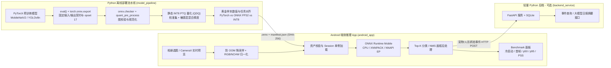

# Android + Python ONNX 端侧实战项目方案：EdgeVision-ONNX

> **文档定位**：面向「AI 应用工程师 / 端侧智能体 / 智能家居」岗位求职的 3～5 天高性价比实战项目蓝图。
> **核心目标**：以通用端侧视觉引擎 **`EdgeVision-ONNX`** 为载体，聚焦**智能相册离线打标**与**宠物监控端侧检测**两大典型家庭场景，同步补齐简历中的 **Python 工程代码、PyTorch 导出 ONNX、PTQ 量化对齐、Android 端侧推理与多后端性能调优** 四大短板。

---

## 一、项目定位与 JD 匹配度分析

### 1. 为什么定名为 `EdgeVision-ONNX`（承载智能相册 / 宠物监控场景）？

| 维度 | 具体价值 | 对应目标岗位职责 |
| :--- | :--- | :--- |
| **通用命名 + 业务落地** | 仓库名 `EdgeVision-ONNX` 通用性强，适配各类端侧视觉/AI 应用岗位；内部聚焦「智能相册离线打标」与「实时宠物/人形监控抓拍」两大场景 | 智能相册、宠物监控摄像头业务落地 |
| **端侧部署闭环** | 完整走通 PyTorch → ONNX → INT8 PTQ 量化 → Android ONNX Runtime 推理与后处理（分类/检测） | AI 算法工程化集成、优化与端侧部署 |
| **性能剖析实证** | 在真机上对比 CPU / XNNPACK / NNAPI 多 Execution Provider 的延迟与内存数据 | 推理性能调优与目标设备稳定性验证 |
| **Python 工程补齐** | Python 负责导出/量化/校验流水线，并可扩展轻量 FastAPI 接收端侧告警事件 | Python 开发、AI 模块接口设计与联调 |
| **投入产出比高** | 无需从零训练模型，先用 `MobileNetV2` 跑通分类与量化全链路，再平滑扩展至 `YOLOv8n` 检测框与 NMS，3～5 天即可产出可演示、可量化的成品 | 快速弥补短板，兼顾简历投递节奏 |

---

## 二、整体架构与仓库目录规划

### 1. 端云协同与部署流水线架构



### 2. 仓库目录结构（Monorepo）

```text
EdgeVision-ONNX/
├── .gitignore                      # 忽略 .venv/、__pycache__/、*_prep.onnx 等
├── README.md                       # 架构图、量化踩坑复盘、真机 Benchmark 实测表
├── docs/
│   ├── model_contract.md           # 输入输出 shape、布局(NCHW)、归一化与类别契约
│   └── benchmark_report.md         # 真机实测数据、EP 回退分析与结论
├── model_pipeline/                 # [阶段 1 - 已跑通] Python 模型导出、量化与校验
│   ├── requirements.txt            # Python 3.10+ 依赖（含 torch/onnx/onnxruntime/onnxscript）
│   ├── preprocess.py               # 统一图像预处理契约（Android 端 1:1 对齐）
│   ├── export_onnx.py              # PyTorch -> ONNX FP32 + onnx.checker + SHA-256 清单
│   ├── quantize_ptq.py             # 静态 INT8 PTQ (QDQ) 量化与敏感层排除
│   ├── verify_alignment.py         # 黄金样本数值误差与 Top-1 一致率回归
│   └── calib_images/               # 30~50 张校准与验证图片
├── artifacts/                      # 导出产物（.onnx、manifest.json、alignment_report.json）
├── android_app/                    # [阶段 2 & 3] Android ONNX Runtime 端侧应用
│   └── app/src/main/
│       ├── assets/                 # 存放 mobilenet_v2_fp32/int8.onnx 与 manifest.json
│       └── java/.../edgevision/
│           ├── ml/                 # OrtSession 管理、预处理、分类/NMS 后处理
│           ├── benchmark/          # 多 EP (CPU/XNNPACK/NNAPI) 50 帧基准测试
│           └── ui/                 # 智能相册识别页、CameraX 宠物监控页
└── backend_service/                # [阶段 4 可选] Python FastAPI 端云联动服务
    ├── main.py                     # 接收端侧检测抓拍、事件查询、日报生成
    └── schemas.py                  # Pydantic 请求/响应契约
```

---

## 三、四阶段落地实施计划与当前进度

### 阶段 1：Python 模型导出、PTQ 量化与数值对齐（已完成基线跑通）

**核心产出**：基于 Python 3.10 构建了可复现的导出、量化与对齐流水线，并在 `artifacts/` 下产出模型与实测报告。

1. **已验证的工程排障记录（面试高分素材）**：
   * **导出器与单文件打包**：新版 PyTorch 默认 `dynamo` 导出器强制 opset 18 且会拆分外部权重（`.onnx.data`），不利于 Android `assets/` 打包；显式指定 `dynamo=False` + `opset_version=17` 后稳定导出单文件 FP32 ONNX。
   * **模型架构对静态 PTQ 的敏感度对比**：
     * `MobileNetV3-Small`（含 HardSwish 与 SE 注意力）全图静态 PTQ 出现严重精度崩塌（Top-1 仅 `3.3%`）；开启 `reduce_range=True` 并排除首尾敏感层回退 FP32 后，余弦相似度拉升至 `0.878`、Top-1 恢复至 `50.0%`，但体积反弹至 `7.70 MB`。
     * 切换为带天然上界 `ReLU6` 的 `MobileNetV2` 后，静态 INT8 PTQ 表现显著更稳，验证了“**转换成功不等于精度达标**”的上线铁律。
2. **当前 `MobileNetV2` 实测对齐基线（30 张样本）**：
   * **FP32 导出对齐**：体积 `13.99 MB`，`max_abs_error_mean = 6e-06`，余弦相似度 `1.0000`，Top-1 一致率 `30/30 (100.0%)`。
   * **INT8 QDQ 量化**：体积压至 `3.94 MB`（**压缩 71.8%**），`max_abs_error_mean = 1.542656`，余弦相似度 `0.90014`，Top-1 一致率 `19/30 (63.3%)`。
3. **后续可选升级**：
   * 替换 `calib_images/` 为真实宠物/家居场景照片，并分离校准集与测试集、补充 Top-5 一致率统计。
   * 若需升级为宠物监控目标检测画框，可按同一流水线接入 `YOLOv8n`（COCO 原生含 `cat`/`dog`/`person`），增加 Letterbox 与 NMS 对齐。

---

### 阶段 2：Android ONNX Runtime 端侧推理 App（预计 1.5 天）

**核心产出**：可在真机流畅运行的智能相册 + 实时监控演示 App。

1. **依赖引入**：
   * 在 Gradle 中引入 `com.microsoft.onnxruntime:onnxruntime-android`（以及 `CameraX` 相关依赖）。
2. **端侧资产与会话治理**：
   * 将 `mobilenet_v2_fp32.onnx`、`mobilenet_v2_int8_qdq.onnx` 及 `manifest.json` 打包进 `assets/`，启动时校验文件大小/SHA-256。
   * 封装单例 `OnnxClassifier` / `OnnxDetector`，复用 `OrtEnvironment` 与 `OrtSession`，**严禁在主线程执行加载与推理**。
3. **防 OOM 预处理（与 `preprocess.py` 1:1 严格对齐）**：
   * 复用 `inJustDecodeBounds` 预读尺寸 + 2 的幂采样策略，防止相册原图解码 OOM。
   * 纠正 EXIF 方向，缩放到 `224x224`（若为检测模型则做 Letterbox 等比缩放并记录 padding 偏移），转为 RGB、归一化至 `[0, 1]` 并按 ImageNet `mean/std` 标准化，按 **NCHW** 布局写入 `FloatBuffer`。
4. **后处理与业务闭环**：
   * **智能相册页**：选择本地图片 → 离线输出 Top-K 类别与置信度（或检测框），生成相册标签。
   * **宠物监控页**：CameraX 实时取帧（控制分析帧率与丢帧背压，避免帧堆积）→ 实时识别宠物/人物并触发抓拍日志。

---

### 阶段 3：真机多后端 Benchmark 与性能剖析（预计 0.5 天，面试最高分项）

**核心产出**：可一键复现的端侧 Benchmark 页面 + `docs/benchmark_report.md` 实测报告。

1. **对比维度**：
   * 模型精度：`FP32 (13.99 MB)` vs `INT8 QDQ (3.94 MB)`。
   * Execution Provider：`CPU (1/2/4 线程)` vs `XNNPACK EP` vs `NNAPI EP`。
2. **必须拆解记录的真实指标**（固定机型、系统版本、电量/散热状态，预热 5 帧后连续跑 50 帧）：
   * **资产指标**：模型文件体积（MB）。
   * **生命周期指标**：冷启动加载耗时（ms）、首帧推理耗时（ms）。
   * **稳态分阶段延迟（p50 / p95）**：拆分记录 `预处理耗时` + `纯推理耗时` + `后处理耗时` = `端到端总耗时`。
   * **内存指标**：使用 `adb shell dumpsys meminfo <package>` 记录稳态与峰值 PSS 内存（MB）。
3. **关键加分点（诚实剖析与平台认知）**：
   * Android 15/16 已将 NNAPI 标记为 deprecated，不同芯片厂商驱动对 INT8/算子支持差异极大。
   * **如果实测发现 NNAPI 或 INT8 在真机上反而比 XNNPACK FP32 更慢**，务必如实记录并分析原因（如算子不支持触发图切分与 CPU 回退、反量化开销或跨后端拷贝）。

---

### 阶段 4（可选加分）：轻量 Python FastAPI 端云联动服务（预计 1 天）

**核心产出**：100～150 行规范的 Python 后端代码，补齐 JD 第 4 条「业务后端开发与联调」。

1. **接口设计（`backend_service/`）**：
   * `POST /api/v1/events/pet`：接收 Android 端侧检测到宠物后的抓拍缩略图、类别、置信度、时间戳与设备 ID（支持 `Idempotency-Key` 幂等防重）。
   * `GET /api/v1/events`：按时间/宠物类型分页查询历史监控事件（SQLite 落库）。
   * `POST /api/v1/reports/daily`（可选）：汇总当日检测事件，调用 OpenAI 兼容 LLM 生成一句“今日宠物活动日报”。
2. **工程规范**：
   * 使用 Pydantic 定义输入输出契约、统一错误码信封与请求体大小上限校验。

---

## 四、简历项目描述模板（已预填阶段 1 实测数据）

> ### EdgeVision-ONNX — 端侧视觉模型部署流水线与智能相册/宠物监控引擎（独立开源）
> **项目链接**：`https://github.com/【你的用户名】/EdgeVision-ONNX`
> **技术栈**：Python ｜ PyTorch / ONNX / ONNX Runtime (PTQ) ｜ FastAPI（可选） ｜ Android ONNX Runtime Mobile (CPU/XNNPACK/NNAPI) ｜ CameraX
> - **模型导出、静态 PTQ 量化与数值对齐（Python）**：基于 Python 搭建 PyTorch 到 ONNX（opset 17 单文件）的自动化导出、图校验与 SHA-256 资产清单流水线；对比 `MobileNetV3-Small` 与 `MobileNetV2` 在静态 INT8 PTQ 下的敏感层误差表现，结合敏感层混合精度回退与 `reduce_range` 策略，实现 `MobileNetV2` FP32（13.99 MB，余弦 1.0、Top-1 100%）向 INT8 QDQ（3.94 MB，体积压缩 71.8%、余弦 0.900）的量化回归。
> - **Android 端侧推理集成与业务闭环**：基于 `onnxruntime-android` 与 CameraX 实现智能相册离线打标及实时宠物监控识别；严格对齐 Python 侧预处理契约（预读尺寸降采样防 OOM、EXIF 校正、RGB/NCHW 标准化），封装 `OrtSession` 单例复用与后台异步推理。
> - **多后端真机 Benchmark 与瓶颈剖析**：在真机（【填入机型/芯片/Android 版本】）对比 FP32/INT8 与 CPU、XNNPACK、NNAPI 的冷启动、首帧、稳态 p50/p95 延迟（【实测 ms】）及峰值 PSS 内存（【实测 MB】），拆解预处理/推理/后处理耗时并定位算子回退原因。
> - **端云协同服务联调（可选）**：使用 Python FastAPI + SQLite 实现宠物抓拍事件上报（含幂等防重）与查询接口，打通端侧检测触发与服务端记录链路。

---

## 五、面试高频追问自查清单

1. **导出 ONNX 时遇到过什么契约坑？**（回答要点：`eval()`、PyTorch 新版 `dynamo` 导出器拆分外部权重与 opset 18→17 兼容问题、固定 shape、NCHW 布局对齐。）
2. **怎么证明量化后的 INT8 模型没有掉点？**（回答要点：用黄金样本对比张量误差与任务级 Top-1 一致率；结合 `MobileNetV3-Small` 崩塌与 `MobileNetV2` 混合精度对比实测说明。）
3. **在你的真机上，CPU、XNNPACK、NNAPI 谁最快？为什么？**（回答要点：报出真实 p50/p95 数据，结合算子覆盖、子图切分回退、反量化开销和 Android 15+ NNAPI 弃用现状解释。）
4. **端到端耗时里，模型推理占了多少？前后处理怎么优化？**（回答要点：展示分阶段计时数据，说明降采样、Buffer 复用、CameraX 丢帧策略和后台线程隔离。）
5. **如果以后要部署到公司的智能摄像头或扫地机 NPU 上，你会怎么做迁移？**（回答要点：保持前/后处理契约与黄金样本校验不变，将推理后端替换为厂商 NPU 离线编译工具链，补充温度/功耗与端云回退验收。）